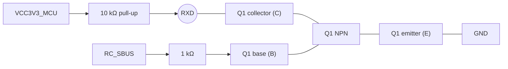

# I6X

## 1. 模块作用 / Purpose

本模块从专用 UART 接收 Flysky 遥控链路，使用一个配置参数选择 SBUS 或 iBus，校验并发布统一的 `I6X::Data` Topic。Topic 只携带 16 路归一化浮点通道；协议原始值、校验和与链路状态仅在模块内部用于解析和超时处理。

This module receives a Flysky receiver link over a dedicated UART. One configuration parameter selects SBUS or iBus, and validated frames are published as a unified `I6X::Data` Topic containing only 16 normalized float channels. Raw protocol values, checksums and link status are kept internal for decoding and timeout handling.

## 2. 协议与设备支持 / Protocol and Device Support

| 协议 / Protocol | UART | 帧 / Frame | 通道 / Channels |
| --- | --- | --- | --- |
| SBUS | 100000 baud, 8E2 | 25 bytes, header `0x0F` | 16 x 11-bit |
| iBus | 115200 baud, 8N1 | 32 bytes, length `0x20`, command `0x40` | 14 x 16-bit |

SBUS 标准信号为反相信号；BSP 必须提供反相输入或使用接收端的非反相输出。iBus 为非反相信号。SBUS 没有校验和，只检查帧头和帧尾；iBus 使用 `0xFFFF` 减去前 30 字节的校验和。

Standard SBUS is inverted; the BSP must provide an inverter or a receiver output that is already non-inverted. iBus is non-inverted. SBUS has no checksum and validates only its header and footer; iBus uses `0xFFFF` minus the first 30 bytes as its checksum.

接收机和发射机的协议能力必须按实际型号配置：

The protocol capability depends on the exact transmitter and receiver model:

I6 不支持 SBUS，只支持 iBus。6 通道 I6X 支持 SBUS 和 iBus；IA6 不支持 SBUS、只支持 iBus；6 通道 IA6B 支持 SBUS 和 iBus；IA10B 支持 SBUS 和 iBus，并提供 10 个通道。

I6 supports iBus only. The 6-channel I6X and 6-channel IA6B support both SBUS and iBus; IA6 supports iBus only; IA10B supports both protocols with 10 channels.

| 设备 / Device | SBUS | iBus | 通道 / Channels |
| --- | --- | --- | --- |
| I6 发射机 / I6 transmitter | 不支持 / No | 支持 / Yes | — |
| 6 通道 I6X 接收机 / 6-channel I6X receiver | 支持 / Yes | 支持 / Yes | 6 |
| IA6 接收机 / IA6 receiver | 不支持 / No | 支持 / Yes | 6 |
| 6 通道 IA6B 接收机 / 6-channel IA6B receiver | 支持 / Yes | 支持 / Yes | 6 |
| IA10B 接收机 / IA10B receiver | 支持 / Yes | 支持 / Yes | 10 |

模块为协议帧解析各自协议的最大通道数；SBUS 解析 16 路，iBus 解析前 14 路。6 或 10 通道接收机按设备型号使用前 N 路，Topic 中未使用的归一化通道元素为零。

The decoder handles the protocol maximum channel count: 16 channels for SBUS and the first 14 channels for iBus. A 6-channel or 10-channel receiver uses the first N channels for its model; unused normalized Topic elements remain zero.

Topic 的 `Data::normalized[]` 使用 `-1..1` 表示通道值。SBUS 使用 `Param::calibration` 归一化；iBus 使用 1000 / 1500 / 2000 的固定最小值、中位值和最大值归一化。

Topic `Data::normalized[]` maps channels to `-1..1`. SBUS uses `Param::calibration`; iBus uses fixed 1000 / 1500 / 2000 minimum, center and maximum values.

### 通道范围与功能 / Channel Ranges and Functions

SBUS 通道是 11 位原始值。`ChannelCalibration` 的默认范围为 `SBUS_CHANNEL_MIN = 240`、`SBUS_CHANNEL_CENTER = 1024`、`SBUS_CHANNEL_MAX = 1807`，每个通道都可以通过 `Param::calibration` 单独调整。原始值只在模块内部使用，Topic 只发布归一化结果。

SBUS channels are 11-bit raw values. `ChannelCalibration` defaults to `SBUS_CHANNEL_MIN = 240`, `SBUS_CHANNEL_CENTER = 1024`, and `SBUS_CHANNEL_MAX = 1807`; each channel can be adjusted independently through `Param::calibration`. Raw values stay internal and only normalized results are published.

iBus 通道使用固定范围：`IBUS_CHANNEL_MIN = 1000`、`IBUS_CHANNEL_CENTER = 1500`、`IBUS_CHANNEL_MAX = 2000`。解析器拒绝超出该范围的 iBus 通道值，并使用这三个原始命名进行归一化。

iBus channels use a fixed range: `IBUS_CHANNEL_MIN = 1000`, `IBUS_CHANNEL_CENTER = 1500`, and `IBUS_CHANNEL_MAX = 2000`. The decoder rejects iBus channel values outside this range and uses these original names for normalization.

| 协议 / Protocol | 最小值 / Minimum | 中位值 / Center | 最大值 / Maximum | 配置 / Configuration |
| --- | --- | --- | --- | --- |
| SBUS | `SBUS_CHANNEL_MIN = 240` | `SBUS_CHANNEL_CENTER = 1024` | `SBUS_CHANNEL_MAX = 1807` | 每通道可通过 `Param::calibration` 调整 / Per-channel through `Param::calibration` |
| iBus | `IBUS_CHANNEL_MIN = 1000` | `IBUS_CHANNEL_CENTER = 1500` | `IBUS_CHANNEL_MAX = 2000` | 固定 / Fixed |

SBUS 和 iBus 的通道功能由遥控器端自行设计和分配。模块只保留协议通道的原始顺序，不预设油门、转向、模式或舵机等功能；应用应根据遥控器配置读取 `Data::normalized[]`。

The functions of SBUS and iBus channels are designed and assigned by the transmitter. The module keeps the original protocol order and does not assign predefined meanings such as throttle, steering, mode or servo. Applications should read `Data::normalized[]` according to the transmitter configuration.

## 3. 构造接口 / Constructor

```cpp
I6X(LibXR::UART& uart,
    const I6X::Param& param = {.topic_name = "i6x",
                               .offline_timeout_ms = 20,
                               .task_stack_depth_uart = 2048,
                               .thread_priority_uart = LibXR::Thread::Priority::HIGH,
                               .calibration = I6X::Calibration{},
                               .protocol = I6X::Protocol::SBUS});
```

`uart` 是必选依赖，且只能由一个接收消费者拥有。`param.protocol` 是协议切换参数，默认使用 `I6X::Protocol::SBUS`：SBUS 配置 100000 8E2，`I6X::Protocol::IBUS` 配置 115200 8N1。`topic_name` 必须非空且每个实例唯一；超时和线程栈大小必须大于零。

`uart` is a required dependency and its RX path must have one consumer. `param.protocol` selects the protocol and defaults to `I6X::Protocol::SBUS`: SBUS configures 100000 8E2, while `I6X::Protocol::IBUS` configures 115200 8N1. `topic_name` must be nonempty and unique per instance; timeout and stack size must be positive.

帧解析也可脱离硬件调用：

The decoder can also be called without hardware:

```cpp
I6X::Data data{};
auto result = I6X::ParseFrame(frame, data, I6X::Protocol::SBUS, sizeof(frame));
```

`ParseFrame` 的协议参数位于第三个位置，省略时默认按 SBUS 解析；需要解析 iBus 时显式传入 `I6X::Protocol::IBUS`。`size` 为零时使用协议默认帧长。

The protocol argument is the third parameter and defaults to SBUS. Pass `I6X::Protocol::IBUS` explicitly for iBus frames. A zero `size` selects the protocol's default frame length.

解析失败时输出保持不变。SBUS 故障帧仍返回 `OK`，但输出的 `Data::normalized[]` 全为零；iBus 校验失败或通道超范围时返回 `CHECK_ERR` 或 `OUT_OF_RANGE`。成功解析时输出只包含归一化通道值。

The output is unchanged on a decode failure. An SBUS failsafe or lost-frame packet returns `OK` with all `Data::normalized[]` elements set to zero; an iBus checksum or range failure returns `CHECK_ERR` or `OUT_OF_RANGE`. Successful decoding exposes only normalized channel values.

## 4. Topic

| 名称 / Name | 方向 / Direction | 类型 / Type | 用途 / Meaning |
| --- | --- | --- | --- |
| `param.topic_name`（默认 / default `i6x`） | 发布 / Publish | `I6X::Data` | `normalized[16]`，范围 `-1..1` / `normalized[16]`, range `-1..1` |

消费者直接读取 `data.normalized[]`；失联超时每次只发布一次全零消息，恢复后继续发布。回调运行在 UART 接收线程中，应及时返回。

Consumers read `data.normalized[]` directly. One zero-initialized message is published per timeout period, and publication resumes after a valid frame. Callbacks run in the UART RX thread and should return promptly.

## 5. 配置示例 / Configuration Example

I6X 是可直接放入 BSP 的Module。下面的实例选择 SBUS；切换到 iBus 时只需把 `protocol` 改为 `I6X::Protocol::IBUS`。

I6X can be included as a Module in a BSP. This instance selects SBUS; switch to iBus by changing only `protocol` to `I6X::Protocol::IBUS`.

```cpp
#include "I6X.hpp"

static I6X i6x_0(
    uart5,
    {.topic_name = "i6x",
     .offline_timeout_ms = 20,
     .task_stack_depth_uart = 2048,
     .thread_priority_uart = LibXR::Thread::Priority::HIGH,
     .calibration = I6X::Calibration{},
     .protocol = I6X::Protocol::SBUS});
```

## 6. 依赖与硬件 / Dependencies and Hardware

模块只依赖 LibXR 的 UART、Topic、Thread 和时间基准，不依赖其他 XRobot Module。BSP 必须先初始化 LibXR，注册匹配协议 UART，并保证接收队列至少能容纳 32 字节。

The module depends only on LibXR UART, Topic, Thread and timebase APIs. The BSP must initialize LibXR first, register a UART matching the selected protocol, and provide an RX queue that can hold at least 32 bytes.

使用 SBUS 时还必须处理信号反相；使用 iBus 时连接非反相 RX。不要让其他任务、驱动或调试输出同时读取同一个 UART 接收端。

SBUS installations must handle signal inversion; iBus uses a non-inverted RX connection. Do not let another task, driver or debug stream read the same UART RX path.

### SBUS 反相输入电路 / SBUS Inverting Input Circuit

下图使用 Q1 NPN 三极管将 `RC_SBUS` 反相为 UART 使用的 `RXD`：`RXD` 通过 10 kΩ 电阻上拉到 `VCC3V3_MCU`，`RC_SBUS` 通过 1 kΩ 电阻连接到 Q1 基极，Q1 发射极接地，集电极连接到 `RXD`。

The circuit below uses Q1 as an NPN inverter for the UART `RXD`: `RXD` is pulled up to `VCC3V3_MCU` through 10 kΩ, `RC_SBUS` drives the Q1 base through 1 kΩ, the emitter is connected to ground, and the collector is connected to `RXD`.


